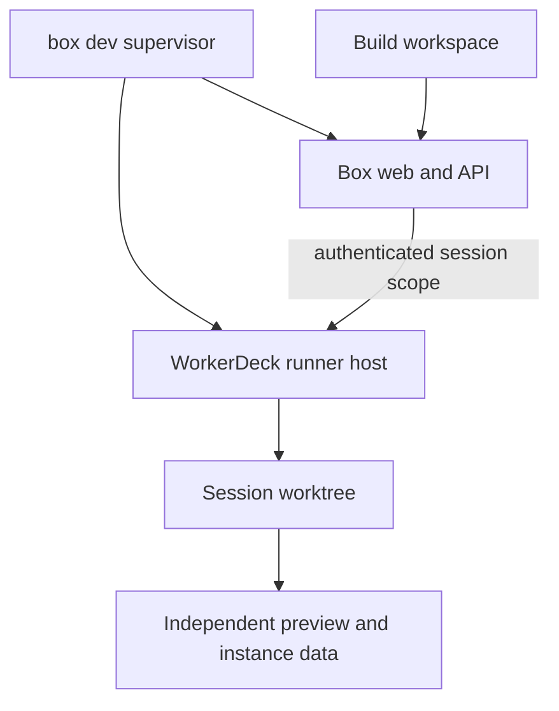

# Build workspace, setup, and Bun exploration

Historical exploration: the subsequent [Bun migration](BUN.md) supersedes the runtime and CLI recommendations below. The recorded probe results remain unchanged.

Date: 2026-09-19. Exploratory findings and proposed direction, not an implemented Build module or runtime migration.

Follow-up: [WorkerDeck Bun compatibility spike](WORKERDECK-BUN.md) records upstream suite
comparisons, native engine subprocess probes, and concrete compatibility gaps.

CLI wrapup: Stack `f368209804c3907e19f7cc7b09f1f0ade5e76aff`, consumer Box `003b14ea49e0dcc197e0a97d5f02befc7a1ba9ee`. Both verification chains and security audits passed before committing. Nothing pushed. This document records the exploration; it does not change the supported runtime or command set.

## Recommendation

Make `box` the user-facing command and Build the browser workspace. Reuse the existing WorkerDeck integration. Prove a real development session through edit, review, verify, preview restart, and reconnect before deciding on a Bun migration.

Bun 1.4.2 is promising on this machine. It booted a fresh core-only Box and passed the focused checks below, but replacing the package manager and replacing the runtime are separate changes. The current verification command assumes pnpm semantics.

## What already exists

WorkerDeck 2.7.2 is already part of the core-only Box, with real Claude and Codex runner adapters:

- `apps/server/src/agent/workerdeck.host.ts` embeds the gateway in the Nest process, loads per-user engine profiles, checks credentials, and parks session state under `data/agent`.
- `apps/server/src/agent/agent.mount.ts` mounts it at `/agent` with Box authentication, CSRF checks, user ownership, and profile restrictions. Browser users are not operators. The create gate currently permits one active session per user.
- `packages/core/src/agent-session.ts` owns session access contracts independently of chat.
- `apps/web/src/lib/agentStore.ts` and `apps/web/src/components/agent/AgentSidebar.tsx` already use WorkerDeck's client and `SessionPanel`.
- Installed `@workerdeck/ui/workspace` exports `SessionWorkspace`, `FileTree`, `EditorTabs`, `FileViewer`, and `CodeEditor`. Reuse these where appropriate; load the optional Monaco editor only when needed.

The missing work is setup, a development workspace, and runner lifecycle. The current browser session uses the live checkout as its working directory. Restarting the Box also shuts down its embedded gateway.

Installed Claude and Codex adapters both advertise resume and backfill support. Older host comments saying Codex cannot resume are stale relative to these capability records. Actual restart recovery still needs a real-engine test. The installed Codex version also differs from WorkerDeck's declared peer range, already recorded in the repository's GOTCHAS.

## Command surface: `box`

User preference: type `box`, not `bun run` or a package-script shortcut.

This shim already exists at `packages/cli/bin/box`; `packages/cli/src/box-install.ts` registers a symlink in `~/.local/bin`. It remembers the invocation directory, resolves symlinks, and launches the CLI directly. The CLI selects the nearest enclosing Box, falling back visibly to the registering checkout. Preserve that behavior.

Current verbs include `where`, `auth`, `db`, `tools`, and an MCP tool fallback. Repository maintenance verbs are currently deliberately excluded. The proposed public surface changes that decision explicitly:

```text
box dev                 start the development environment
box start               start the built Box
box verify              run the visual verification flow
box where               explain the selected checkout
box auth ...            retain existing identity commands
box db ...              retain existing database commands
box tools ...           retain existing MCP access
```

These new verbs are proposed, not implemented. Reserve them before MCP fallback and check tool-name collisions. Keep existing tool invocations working. `box verify` should call the task runner directly, preserving arguments, exit status, cancellation, and TTY behavior. Internal build tools can still use package scripts; the user does not need to know that.

The launcher should use the project's supported runtime deliberately, rather than select whichever executable happens to be available. A Bun-backed launcher would invoke TypeScript with `bun --no-env-file`; Node remains the supported path until the migration is validated. Running `bun run` around a script beginning with `node` does not establish a Bun-only runtime.

Setup should register the existing shim once and check that its directory is on PATH. A direct bootstrap command already works without a package script: `node packages/cli/src/box-install.ts`. No new global package or copied CLI is necessary. A future Bun bootstrap can invoke the same installer after validation.

Read-only local check: invoking the repository shim resolved Stack correctly. The existing global `~/.local/bin/box` points at a different checkout, `/Users/atomic/projects/silkweave/box`; the installer reported it as a foreign link and left it alone. No global installation or shell configuration was changed in this exploration.

## Setup and Build experience

1. Clone and run the bootstrap. Check the supported runtime, install dependencies, prepare generated code, and register `box`.
2. Choose the system principal before first boot. Keep the first human's creation and sign-in link on the local host; do not introduce an unauthenticated web bootstrap.
3. Run `box dev` to start the Box and open its URL. One launcher can supervise multiple processes.
4. After signing in, guide the user through engine readiness, credential availability, and profile selection. Provider credentials remain separate from Box access tokens. Replace stale references to `config/agent-profiles.json` with the current settings model when implementing onboarding.
5. Open Build: choose a task, start a session in an isolated worktree, follow the existing transcript and approvals, inspect changes, run verification, and open a preview.

Build should prioritize session status, approvals, changed files/diff, verification, and preview. A full editor is optional. Start with one user and one session; introduce concurrency only after defining project/worktree ownership and revising the current one-active-session gate.

## Runner lifetime and isolation

Recommended eventual topology:



The runner host should survive application reloads while developing the Box itself. The current in-process request Symbol used to convey principal scope cannot cross that process boundary. A separate host requires authenticated scope transport or IPC, preserving owner and profile restrictions; forwarding a blanket operator credential to browsers is not an equivalent implementation.

Use a separate worktree and independent instance data/ports for previews. Do not let two servers share a warehouse. Keep background automation disabled in development rehearsals. Apply existing migration backup and identity rules when changes require migrations.

Host file access is deliberately disabled today. Enable only the intended workspace roots, excluding local secrets, provider homes, and instance data. Confirm those restrictions in the server, not merely the file-tree UI.

## Bun evidence

Tested on macOS arm64 with a temporary Bun 1.4.2 binary; the machine's installed Bun was left unchanged. Node comparison probes used Node 24.15.0. The independent consumer clone came from Box commit `003b14e`, outside the live `box/` checkout, with its own data and no copied credentials.

| Probe | Result | Scope |
| --- | --- | --- |
| Fresh Bun dependency install | Passed, 793 packages | Used `--ignore-scripts`; not a complete default-install rehearsal |
| DuckDB native query | Passed on Node and Bun | In-memory query through existing installed dependency |
| better-sqlite3 native query | Passed on Node and Bun | In-memory query; chat dependency, not core-only coverage |
| Nest constructor metadata | Passed | Bun emitted `design:paramtypes` |
| WorkerDeck server lifecycle | Passed on Node and Bun | Empty gateway, profiles endpoint 200, request/upgrade listeners present, clean close |
| CLI tests | 29 passed | Fresh Bun-installed clone |
| Core Vitest suite | 120 passed | Fresh clone, Vitest launched by Bun |
| Server Vitest suite | 32 passed | Passed after building provider-kit; initial missing-built-package failure |
| Vitest runtime identity | Passed separately | Asserted `process.versions.bun === '1.4.2'` inside a test worker |
| Type generation | Passed | 26 actions and 16 tRPC procedure types |
| Schema check | Passed | Core-only: 1 feature, 4 tables, fresh boot and reboot |
| Web build | Passed | Existing chunk-size warning |
| Box source server boot | Passed | Bun executed Nest source, served built SPA |
| Chrome browser smoke | Passed | Sign-in page rendered; no warning/error console messages; auth/me returned 200 |
| Unmodified `bun run verify --plain` | Failed at Build | Runner invoked `bun build` as the bundler instead of a package script |

The browser smoke used ports 18791/18792, disabled background work, and disabled WorkerDeck in the Box config. The separate WorkerDeck probe did not launch an agent. The temporary server was stopped afterward.

No authenticated browser workflow, paid engine turn, streaming session, approval round trip, cancellation, parked-session recovery, or concurrent runner load was tested. These are prerequisites for claiming real-runner Bun compatibility. The Stack's full reference-feature chain was not rerun under Bun, and this is not a full Bun `verify` pass.

### Reproduction and artifacts

Temporary experiment root: `/tmp/silkweave-build-exploration-20260919`. Logs are named `bun-*.log`; the independent clone is `box-bun`; the downloaded executable is `bun142/package/bin/bun`. Small dependency probes and their output are retained locally under `_docs/spike/build/probes/` (gitignored). They are optional investigation artifacts, not required runtime files. Temporary logs and the scratch clone are machine-local and may be cleaned up.

Representative commands from the independent clone, with `BUN_EXPERIMENT` pointing at the temporary executable:

```sh
"$BUN_EXPERIMENT" install --ignore-scripts --cache-dir /tmp/silkweave-build-exploration-20260919/bun-cache
"$BUN_EXPERIMENT" --no-env-file test packages/cli/src/tests
"$BUN_EXPERIMENT" --no-env-file --conditions=@silkweave/box-source apps/server/scripts/typegen.ts --quiet
"$BUN_EXPERIMENT" --no-env-file --conditions=@silkweave/box-source packages/core/scripts/schema-check.ts
"$BUN_EXPERIMENT" --bun --no-env-file run --filter @silkweave/box-provider-kit build
"$BUN_EXPERIMENT" --bun --no-env-file run --filter @silkweave/box-web build
```

For Vitest, run `"$BUN_EXPERIMENT" --no-env-file ../../node_modules/vitest/vitest.mjs run` from `packages/core` or `apps/server`. Runtime boot used `"$BUN_EXPERIMENT" --no-env-file --conditions=@silkweave/box-source apps/server/src/main.ts` after creating independent local port/background settings. Do not reuse the live Box's data or credentials to reproduce this.

### Migration considerations

- Bun migrated the pnpm lock into `bun.lock` and added package.json workspaces in the scratch clone. A migration needs a deliberate single-lockfile and workspace policy. See [Bun installation documentation](https://bun.sh/docs/pm/cli/install).
- Dependency lifecycle scripts need an explicit trust policy. The successful install above disabled them, then ran preparation/build steps explicitly. It does not prove an unattended fresh install.
- Bun loads dotenv files by default. Preserve the Box JSON configuration contract using `--no-env-file`. See [Bun environment handling](https://bun.sh/docs/runtime/environment-variables).
- Bun's Node compatibility remains API-specific. Native smoke results and Nest boot are positive evidence, but do not establish runner process/IPC compatibility. See [Node compatibility](https://bun.sh/docs/runtime/nodejs-compat) and [Node-API support](https://bun.sh/docs/runtime/node-api).
- Teach task orchestration explicit runtime/package-manager invocation. The observed verify failure is a command-dispatch mismatch, not evidence of a Nest or database failure.

## Next bounded implementation

Keep Node/pnpm underneath the initial `box` command extension. Build one real session workflow in an independent worktree: start, stream, approve, edit one file, inspect its diff, run `box verify`, reload its preview, reconnect, and cancel. Test ownership and credential isolation along that path. Then test runner survival across app restarts, followed by a repeat of the same workflow under Bun. This separates product and lifecycle issues from runtime migration issues.
